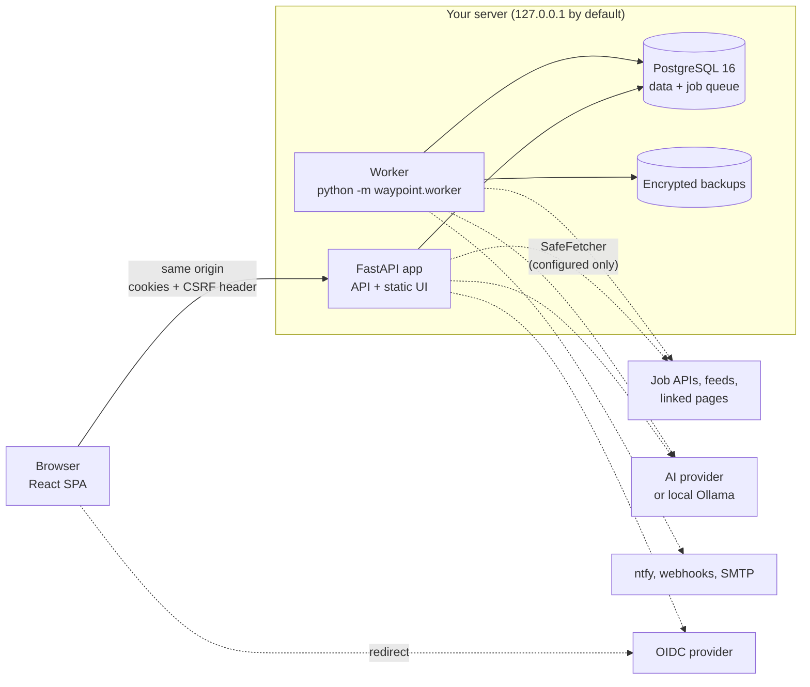
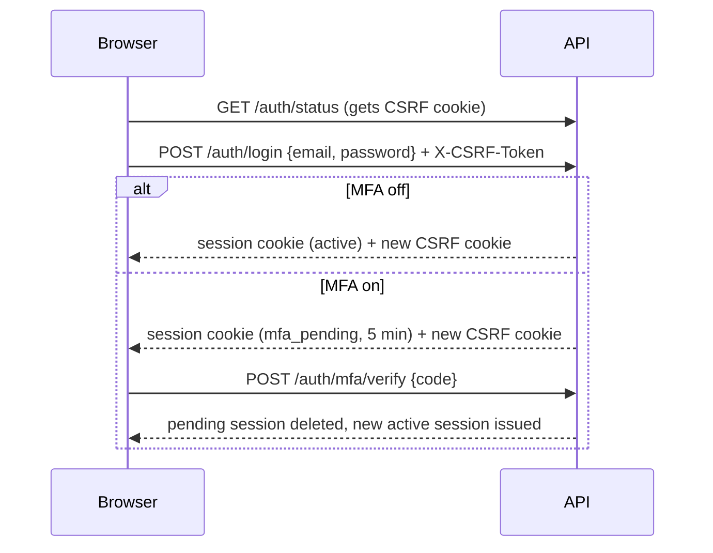
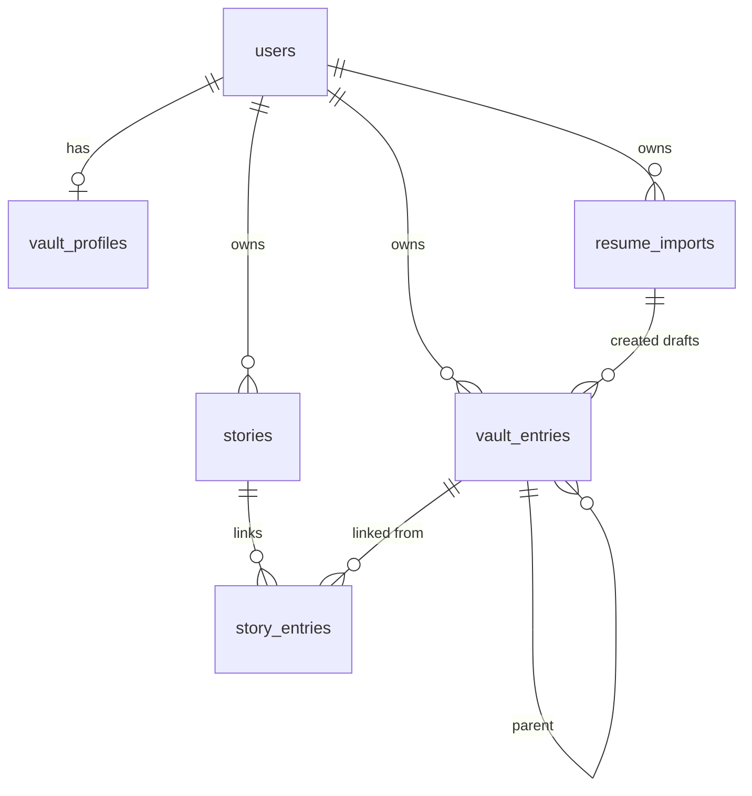
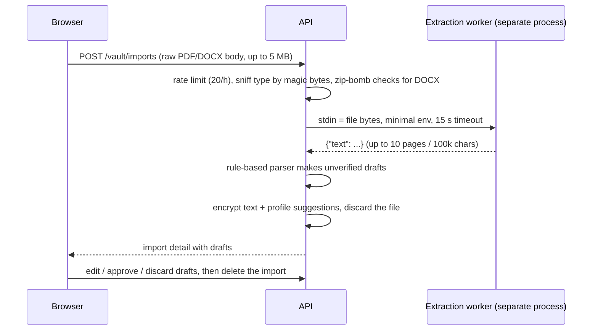
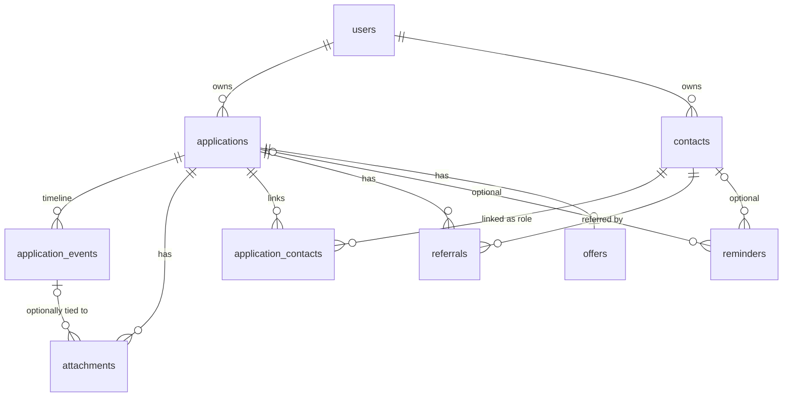
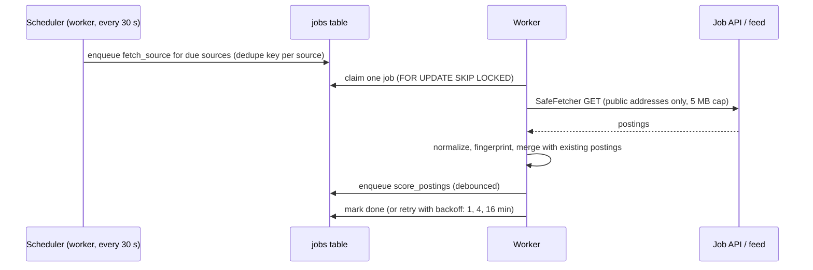

# Architecture

## Overview

Two processes share one database: the **app** (API + UI) and the **worker** (scheduled job-source fetches, scoring, notifications, backups, daily maintenance). One process serves both the API (`/api/...`) and the built UI. Keeping a single origin lets the Content-Security-Policy stay strict (`default-src 'self'`, no inline script) and keeps CSRF handling simple. For remote access, put a TLS reverse proxy in front.

## Backend (`backend/waypoint`)

| Module | Role |
|---|---|
| `main.py` | App factory. Wires up middleware, routers, health checks, and SPA serving. |
| `config.py` | Typed settings from env vars or `*_FILE` secrets. |
| `db.py` | Async SQLAlchemy engine/session, declarative base with naming conventions. |
| `models.py` | `User`, `AuthSession`, `MfaRecoveryCode`, `AuditLog`, `RateLimitHit`, and the vault tables: `VaultProfile`, `VaultEntry`, `Story`, `StoryEntry`, `ResumeImport`. |
| `auth/sessions.py` | Session lifecycle, cookies, CSRF check, `require_user` dependency. |
| `auth/routes.py` | `/api/v1/auth/*`: register, login, MFA, sessions, password. |
| `security/` | argon2id passwords, TOTP + recovery codes, AES-GCM field cipher, rate limiter, security-header and body-size middleware. |
| `vault/schemas.py` | One strict Pydantic schema per entry kind, validated against the `data` JSONB column. Allowed parent kinds. |
| `vault/service.py` | Per-user data access helpers. Every query filters by `user_id`, and other users' rows are "not found". Computes `usable` (verified, with every ancestor verified). |
| `vault/routes.py` | `/api/v1/vault/*`: profile, entries, bulk verify, summary, stories. |
| `vault/imports.py` | `/api/v1/vault/imports`: raw-body upload, review detail, delete (optionally discarding drafts). |
| `vault/importer/` | `guards.py` (type sniffing, zip-bomb checks, filename cleaning), `extract.py` + `worker.py` (text extraction in a separate process), `parse.py` (rule-based text-to-drafts parser). |
| `tracker/models.py` | `Application`, `ApplicationEvent`, `Attachment`, `Contact`, `ApplicationContact`, `Referral`, `Reminder`, `Offer`. |
| `tracker/routes.py` | `/api/v1/tracker/*`: applications, stage changes, timeline events, offers, summary. |
| `tracker/people.py` | Contacts, application links, referrals, reminders, and the agenda. |
| `tracker/files.py` | Attachment upload (raw body, type sniffing, quota), download, delete. |
| `tracker/service.py` | Per-user lookups, output builders, the agenda merge, and board summaries. |
| `net.py` | `SafeFetcher`: the only outbound HTTP client for user-configured addresses (SSRF guard, pinned DNS, manual redirects, size cap), `robots_allows`, and the demo-mode `OfflineFetcher`. |
| `discovery/` | Job sources (`adapters.py`: Greenhouse, Lever, Ashby, Adzuna, USAJOBS, JSearch, RSS/Atom), normalization (`normalize.py`: pay, work mode, shifts, clearance, fingerprints), filters and storage (`service.py`), link and text import (`page_import.py`), and the `/api/v1/discovery` routes. |
| `worker/` | Postgres job queue (`queue.py`: `FOR UPDATE SKIP LOCKED`, dedupe keys, backoff), the runner and scheduler (`runner.py`), and `python -m waypoint.worker`. Other modules register handlers and schedule hooks. |
| `ai/` | Providers (Claude via the official SDK, OpenAI-compatible, Ollama) behind one interface; prompt templates (`prompts/*.txt`, versioned); untrusted-data wrapping, PII redaction, strict JSON schemas (`prompting.py`); facts from the vault (`facts.py`); budgets, rate limits, and run logging (`service.py`); rule and AI fit scoring (`scoring.py`); `/api/v1/ai`. |
| `materials/` | Resume and cover-letter building with per-line fact citations and the fact check (`build.py`), DOCX/PDF export (`export.py`), `/api/v1/materials`. |
| `assistant/` | Conversations with tool use (`chat.py`, `tools.py`), pending actions, interview questions and mock interviews (`interview.py`), `/api/v1/assistant` and `/api/v1/interview`. |
| `insights/` | Funnel, response rates, and response times from stage history (`service.py`), `/api/v1/insights`. |
| `notify/` | Notification settings and log, digest and match-alert builders, channel senders (SMTP, ntfy, Discord, Slack, JSON), worker hooks, `/api/v1/notifications`. |
| `data/` | Value codec, per-user export/import (`portable.py`), encrypted whole-database backups and restore (`backup.py`), the backup job, `/api/v1/data`, and `python -m waypoint.data`. |
| `auth/oidc.py` | OpenID Connect sign-in, account linking, and re-authentication, `/api/v1/auth/oidc`. |
| `demo.py` | The fictional demo account and its seed data. |
| `security/contexts.py` | Every encryption context (the associated data binding a value to its row and column), shared by the app, export/import, and re-encryption. |
| `data/rekey.py` | Re-encrypts every encrypted column with the active key (`python -m waypoint.data rekey`, `keys`). |
| `model_registry.py` | Imports every table module, so tools that walk the metadata (backups, export) see every table. |
| `audit.py` | Writes audit entries. |
| `errors.py` | A single error shape: `{"error": {"code", "message"}}`. |

**Sign-in flow**

Sessions are opaque random tokens. Only their SHA-256 hash is stored, so a database leak doesn't hand out live sessions. Every login issues a new token, which prevents session fixation.

## Career Vault data model

- **One table for all facts.** `vault_entries` has a `kind` (role, responsibility, achievement, project, certification, education, skill, link) and a JSONB `data` column validated by the schema for that kind. Phase 6 will link every generated resume bullet to an entry ID, so one table gives a single stable target.
- **Isolation in the database, not only in code.** `vault_entries`, `stories`, and `resume_imports` have `UNIQUE (user_id, id)`. Parent links and story links are **composite foreign keys** on `(user_id, ...)`, so a row can never point at another user's row, even if application code had a bug.
- **Verification.** `verified` + `verified_at` on entries and stories. An entry is *usable* by the AI only if it and all its ancestors are verified.

## Resume import flow

The worker runs with `python -I` and an environment that contains no `WAYPOINT_*` variables, so a parser exploit can't read the database URL or encryption keys from its environment. On Linux it also has a 512 MB address-space limit.

## Tracker data model

- **Same isolation pattern as the vault:** every cross-table reference is a composite foreign key on `(user_id, ...)`. Optional links (reminder to contact, attachment to event) can't use a column-specific `SET NULL` through SQLAlchemy, so the service clears them in the same transaction before deleting the target. Deleting a contact keeps its reminders; deleting a timeline entry keeps its files.
- **Stage history** is written by the server on every stage change (`kind = stage_change`, data `{from, to}`) and can't be edited or deleted through the API. Phase 8's funnel analytics will be built on it.
- **Agenda.** `GET /tracker/agenda?today=YYYY-MM-DD&days=N` merges open reminders, apply-by dates (open applications only), offer deadlines (applications in Offer), and referral follow-ups (unless submitted or declined). Dates are the browser's local calendar dates; the server stores no time zone yet.
- **Attachments** are stored in Postgres as AES-GCM ciphertext (`FieldCipher.encrypt_bytes`, context `user:{id}:attachment:{id}`), so `.env` + `.localdata/` remain everything needed to move or back up the app. Listing queries defer the content column, so file bytes are only read on download.
- **Offers.** Money is stored as integer cents with an ISO currency. Yearly and hourly equivalents use hours per week × 52 and are computed on the server (the UI mirrors the same formula for previews).

## Job discovery and the worker

- **One queue, in Postgres.** A partial unique index on `dedupe_key` (while queued or running) stops duplicates; re-enqueueing moves a queued job earlier. Stale running jobs are re-queued after 15 minutes. `PermanentError` fails a job without retrying (for example, a source whose key was rejected).
- **De-duplication.** A posting's fingerprint is its normalized company, title, and location. The same job from two sources becomes one posting with two *sightings*; later sightings fill in fields the first one lacked.
- **Filters are evaluated, not stored.** `evaluate(posting, filters)` returns pass/fail, reasons, pay versus target, and distance, so changing a filter takes effect at once.
- **Maintenance** runs daily: postings older than 60 days that you never saved or tracked are removed, along with old finished jobs and rate-limit rows.

## AI

- **Provider interface.** `complete(system, turns, tools, schema)` returns text, tool calls, or schema-validated JSON plus token counts. Anthropic's native content blocks are kept and sent back unchanged on the next turn. The Claude client's base URL is pinned, so an `ANTHROPIC_BASE_URL` in the environment can't redirect calls.
- **Prompts** are versioned text files with separate system and user parts; the template name and version are logged with each run.
- **Untrusted data** (postings, pages, resume text) is wrapped in `<untrusted_document>` blocks with look-alike tags neutralized, and every system prompt carries the same rules: data is never instructions.
- **Facts.** `load_facts` returns only usable vault entries and verified stories, each with a stable ID, plus a digest. Scores and documents store the digest they were built from, so they show as stale when the vault changes.
- **Budget and logging.** Every call goes through `_guard` (rate limit, monthly budget) and is logged in `ai_runs` (feature, prompt version, model, tokens, estimated cost, duration, outcome), in its own transaction so failures are logged too.

## Materials

A document's content is JSON: sections of *items*, each with text, cited fact IDs, a status (`linked`, `flagged`, `approved`), and the reasons for a flag. The rule builder assembles a resume straight from the vault; the AI builder may only choose and reword facts, and its output is checked line by line (`check()`): cited IDs must exist and be usable, numbers must appear in the cited facts, and uncited cover-letter paragraphs may not make claims. Export (`DOCX` via python-docx, `PDF` via ReportLab) is refused while any item is flagged.

## Assistant and interview prep

The assistant loop sends the conversation and the tool list to the model, runs read tools immediately, and turns write tools into `pending_actions`. The UI shows each as a card; Confirm runs the tool (re-checking ownership) and Reject records the refusal. The model is told the outcome on its next turn. Interview prep builds questions from templates or the model, links each to verified stories, and stores notes; mock interviews keep their turns in JSON and end after the chosen number of questions.

## Phase 8

- **Insights** read applications and their `stage_change` events; nothing extra is stored. A response is the first stage change into Screening, Interviewing, Offer, Accepted, or Rejected.
- **Notifications.** A schedule hook enqueues `notify_digest` when a user's local time reaches their digest hour (marking the day first, so a failing channel can't cause repeats) and `notify_matches` when scored, unannounced postings qualify. Each posting is marked `notified_at` once considered, whether it was sent or filtered out.
- **Export/import** walk the same table list. Export decrypts encrypted columns into readable fields and writes attachments as files; import validates every value, gives every record a new UUID (rewriting references, including IDs inside JSON such as cited facts), re-encrypts with the importing server's keys, and inserts everything in one transaction.
- **Backups** stream every table (as stored) into a zip inside one `REPEATABLE READ` snapshot, then encrypt it in chunks. Restore checks the schema version and that the database is empty, inserts parents before children, and resets integer sequences.
- **Single sign-on** keeps no server-side flow state: state, nonce, PKCE verifier, return path, and (for linking) the user ID travel in an encrypted cookie. Sessions record how they were created (`method`) and when the user last proved who they are (`reauth_at`), which exports, imports, and first-password setup require to be recent.
- **Demo mode** seeds the fictional account at startup when it's missing and swaps the outbound client for one that refuses every request.

## Frontend (`frontend/src`)

React 19 + TypeScript + Vite. TanStack Query holds server state, and React Router handles navigation. `lib/api.ts` is the only place that calls `fetch`; it adds the CSRF header and turns errors into `ApiError` (including per-field validation messages). `lib/vault.ts` holds the vault types, per-kind form definitions, and queries; `pages/vault/` has the tabs, entry form, story editor, and import review. `lib/tracker.ts` holds tracker types, queries, and pure helpers (money, dates, board sorting, agenda grouping); `pages/tracker/` has the board (native drag and drop plus a per-card "Move to…" menu), list, application page, agenda, contacts, and offer comparison. `lib/discovery.ts`, `lib/ai.ts`, `lib/materials.ts`, `lib/assistant.ts`, `lib/insights.ts`, `lib/notify.ts`, and `lib/data.ts` do the same for the later phases, with pages under `pages/jobs/`, `pages/materials/`, `pages/assistant/`, `pages/interview/`, `pages/insights/`, and `pages/settings/`. Insights charts are plain SVG and CSS (no chart library), with one hue checked for contrast in both themes, keyboard-focusable marks, and a table view for every chart. `lib/links.ts` only lets http(s) addresses become links. Styling is hand-written CSS with design tokens for the light and dark themes.

## Running locally

`backend/scripts/run_local.py` starts an embedded PostgreSQL (`pgserver`, a dev-only dependency), runs migrations, starts the worker as a child process, builds the UI if needed, and serves everything on `127.0.0.1:8080`. It also handles `--demo` (separate database), `--restore`, and `--verify-backup`. In production, Docker Compose uses the official `postgres:16-alpine` image instead.

## Decisions

| Decision | Why |
|---|---|
| asyncpg, not psycopg | psycopg 3 is LGPL-3.0. asyncpg is Apache-2.0. |
| Server-side sessions, not JWT | Can be revoked instantly, nothing sensitive goes to the browser, simpler to reason about. |
| No reverse proxy in Compose | Fewer moving parts. TLS termination is left to the proxy the user already runs. |
| Rate limits and (later) job queue in Postgres | No Redis needed. One database to back up. |
| Field encryption with context binding | A ciphertext copied to another row or column won't decrypt. |
| One vault table with JSONB + per-kind schemas | A single ID space for fact-linking in Phase 6. New kinds need no migration, and Pydantic still rejects unknown fields. |
| Raw-body upload, not multipart | No multipart parser dependency, and one less code path handling untrusted input. |
| Attachments in Postgres, encrypted | One thing to back up and move; no writable volume needed in the read-only container. Files are small (10 MB cap). |
| Native drag and drop, no library | No new dependency. The "Move to…" menu covers keyboard, touch, and screen-reader use. |
| Job queue in Postgres, not Redis/Celery | One database to run and back up; `SKIP LOCKED` is enough for a personal server. |
| One outbound client for every user-supplied address | SSRF rules live in one place and are tested once: feeds, link import, AI endpoints, and notifications all go through it. |
| Official Anthropic SDK for Claude | Typed requests, retries, and structured output; other providers use plain HTTP through the same interface. |
| Rule-based scoring and materials always available | Waypoint is useful with no AI and no cost; AI adds quality, not capability. |
| Fact-check on every generated line | "Truthful by design" is enforced by code and by blocking export, not by asking the model nicely. |
| Assistant writes only through pending actions | The model can't change data, whatever a posting or page tells it. |
| Charts in SVG/CSS | No chart dependency; small, accessible, and themed with the app's tokens. |
| Export decrypted, backups encrypted | Exports move one person's data between servers with different keys; backups protect everyone's data on disk. |
| Fresh IDs on import | The same export can be imported on the server it came from without colliding with the original rows. |
| PyJWT for ID tokens | Well-tested JWS verification (MIT); everything else in the sign-on flow is small and audited here. |
| Rule-based resume parser first | Deterministic, testable, and offline. AI-assisted import waits for the Phase 5 provider layer and its injection defenses. |
